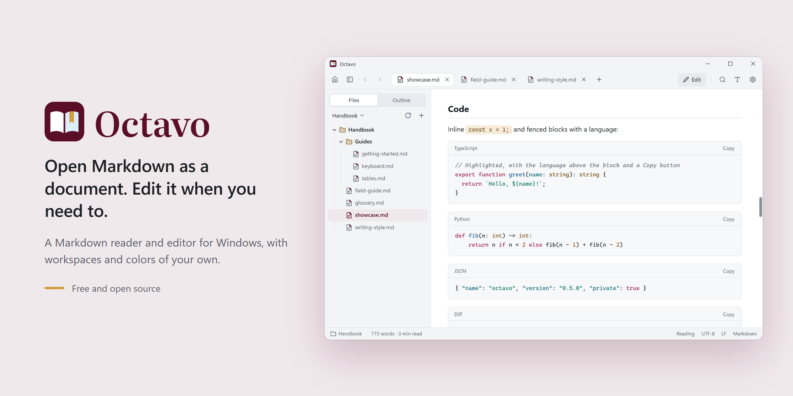
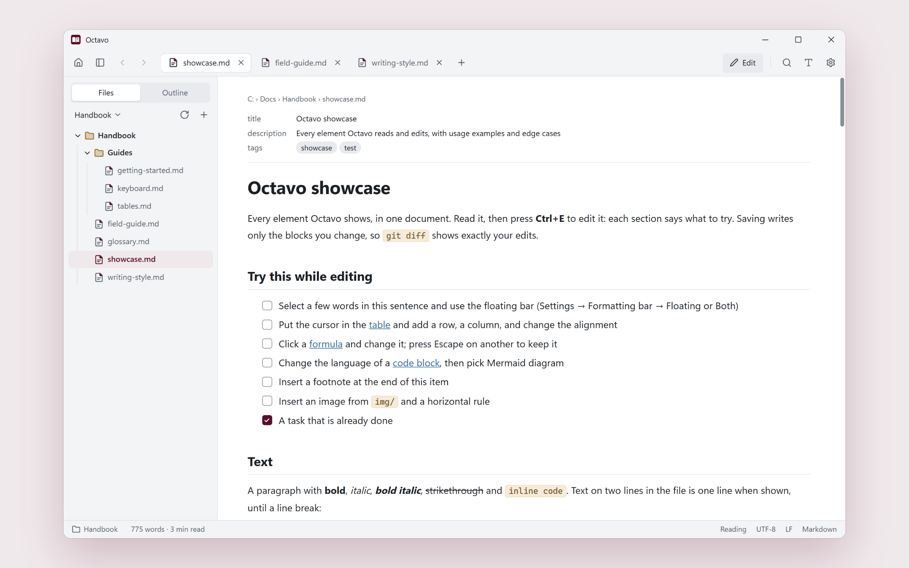
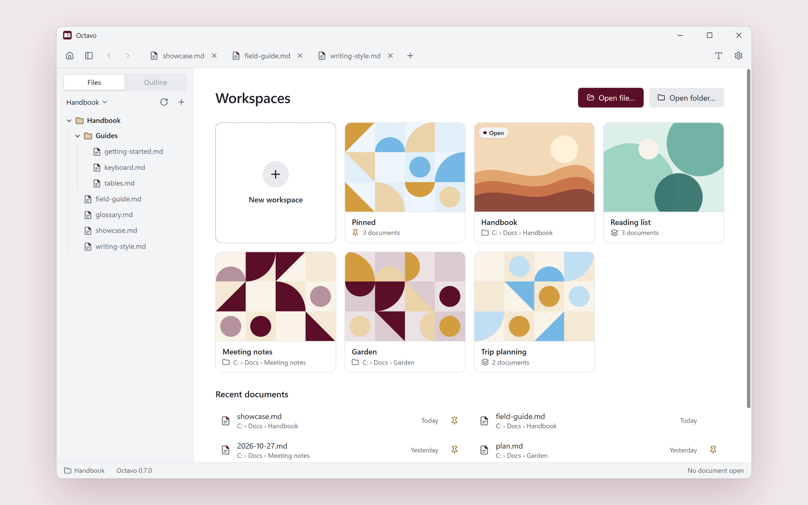
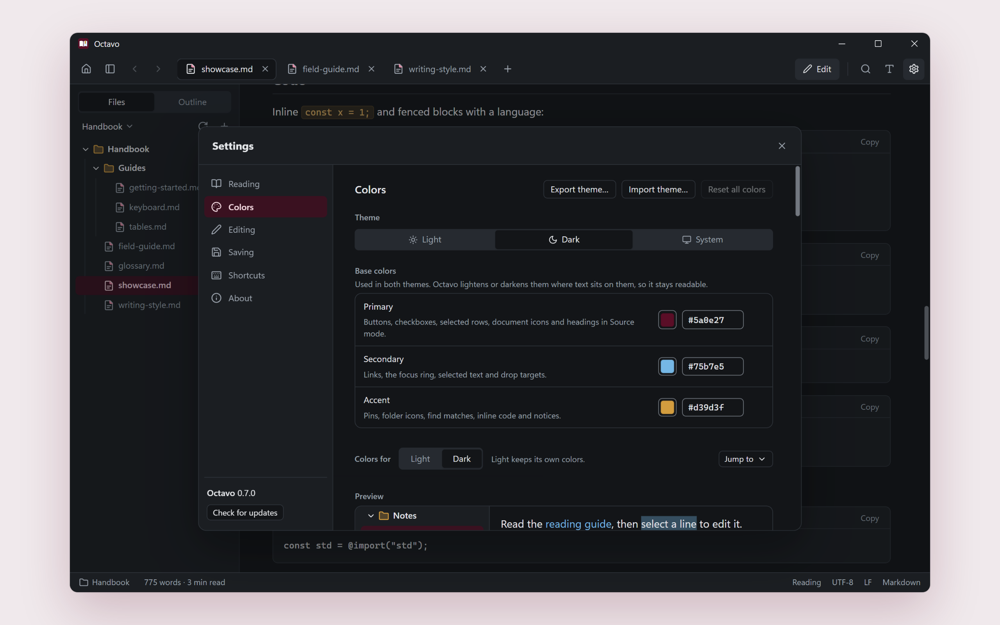

# Octavo

**Open Markdown as a document. Edit it when you need to.**

Octavo is a Markdown reader and editor for Windows. Double-click a `.md` file and it opens as a formatted page, with headings, tables, code, math and diagrams laid out for reading. When something needs a change, press Ctrl+E and edit it right there; Octavo saves back to the same file and leaves the rest of it as it was. Workspaces keep folders and documents together, each with its own tabs.

[**Download for Windows**](../../releases/latest) · Free and open source · MIT license

## Read

A `.md` file opens as a formatted page, with headings, task lists, tables and highlighted code, and the workspace's files beside it.

- **Everything renders:** GitHub Flavored Markdown with tables, task lists and footnotes, math (KaTeX), Mermaid diagrams, images, sanitized HTML, and code with syntax highlighting and a Copy button.
- **Find your way around long documents:** an outline that follows where you are, in the sidebar or beside the text, a breadcrumb, find in document (Ctrl+F), and back and forward between linked files.
- **Frontmatter as properties:** names and values above the document, lists as chips, or hidden if you prefer.
- **Tables that fit:** drag column borders to resize them (remembered per file), and let wide tables and code blocks use the window's width.
- **Open large:** diagrams, images and tables open over the window; diagrams and images zoom and can be dragged.

## Workspaces

Open a folder or gather documents into a workspace of your own, and come back to it from Home. Each workspace keeps its own tabs, and a card can show a picture of your choice.

- **Folders:** Open folder… lists a folder's Markdown documents as a tree in the sidebar's Files tab, and opens them with a click.
- **Workspaces of your own:** make one with New workspace…, and use Add to › on a document, a folder or a tab to put it in Pinned or in any of your workspaces. Removing something from a workspace changes nothing on disk.
- **Quick open (Ctrl+P):** finds a document in the open workspace by folder and file name.
- **Each workspace keeps its tabs:** switching puts one workspace's tabs away and brings back the next one's, and they come back after a restart.
- **Home:** a card for each workspace, with a cover drawn from your colors or a picture of your own, and your recent documents below.
- **Tabs:** drag them into order, reopen a closed tab with Ctrl+Shift+T, and with many open they shrink to fit.

## Edit

- **Edit in place:** Ctrl+E switches the open document between reading and editing at the same spot, with a formatting bar for headings, lists, quotes, links, code, tables and more.
- **Tables, images and diagrams:** add and remove table rows and columns. Drop or paste an image and Octavo saves and links it for you, so the link still works after a commit. Click an image to change its alt text, or a Mermaid diagram to edit it beside a live preview.
- **Source mode (Ctrl+Shift+M):** the document's Markdown in a text editor with colors, line numbers and find and replace, for when you want the raw text.
- **Preview:** see the reading view of your edits before you're done.

## Make it yours

Set the primary, secondary and accent colors, or any single color, for the light and the dark theme, and save them as a theme file.

- **Reading:** light, dark or system theme, sans or serif text, text size, five line widths, and a distraction-free mode (F11).
- **Colors:** the three base colors that the app's colors are drawn from, or each color by itself, for the light and the dark set. A color that is hard to read on its background shows a warning.
- **Theme files:** Export theme… saves your colors to a `.octavo-theme.json` file, and Import theme… brings them back, on this computer or another.
- **Where the tools go:** the formatting bar under the toolbar, floating over selected text, both or hidden.
- **Shortcuts:** every keyboard shortcut can be changed in Settings › Shortcuts, which finds an action by name or by its keys.

## Your files stay yours

- **Saves only what you changed:** the line endings and the text of every block you didn't touch stay exactly as they were, so a one-paragraph edit is a one-paragraph diff.
- **Never overwrites someone else's changes:** if another program changes the file while you edit, Octavo asks whether to reload, keep your version, or compare the two first.
- **A way back:** a copy of each file is kept before its first save in a session, and Revert to original undoes a whole editing session.
- **Autosave**, or save by hand with Ctrl+S if you'd rather.

## Install

Download the installer from [Releases](../../releases/latest): the `.exe` (recommended) or the `.msi`. It registers Octavo for `.md` and `.markdown` files. Octavo checks for a new release when it starts, downloads it in the background and installs it when you restart.

Builds are not code-signed yet, so Windows SmartScreen shows a warning on first install: choose **More info → Run anyway**.

**Status:** Octavo is young and hasn't reached 1.0 yet. It saves straight to your files, so keep your own backups of documents that matter until then. What changed in each release is in the [changelog](CHANGELOG.md).

## Build from source

The requirements and the commands to build and run Octavo are in [CONTRIBUTING.md](CONTRIBUTING.md).

## Contributing

Bug reports and ideas are welcome as [issues](../../issues). To send a change, see [CONTRIBUTING.md](CONTRIBUTING.md).

## License

[MIT](LICENSE). Octavo is free and open source.
