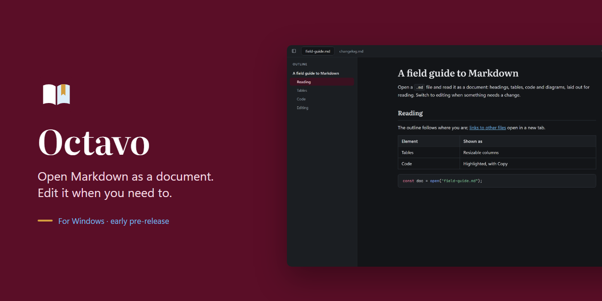
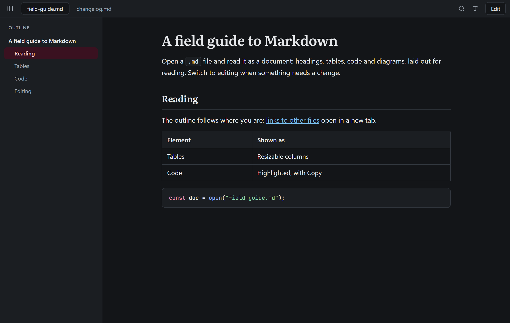

# Octavo

**Read Markdown as a document. Edit it when something needs a change.**

Octavo is a lightweight Markdown reader and editor for Windows. Double-click a `.md` file and it opens as a formatted page, with headings, tables, code, math and diagrams laid out for reading. No raw source to squint at, no workspace to set up, no account. When you spot a typo or want to add a section, press Ctrl+E and edit right there; Octavo saves back to the same file and leaves the rest of it as it was.

[**Download for Windows**](../../releases/latest) · Free and open source · MIT license

## Read

- **Everything renders:** GitHub Flavored Markdown with tables, task lists and footnotes, math (KaTeX), Mermaid diagrams, images, sanitized HTML, and code with syntax highlighting and a Copy button.
- **Find your way around long documents:** an outline that follows where you are, a breadcrumb, find in document (Ctrl+F), and back and forward between linked files.
- **Frontmatter as properties:** names and values above the document, lists as chips, or hidden if you prefer.
- **Tables that fit:** drag column borders to resize them (remembered per file), and let wide tables and code blocks use the window's width.
- **Make it yours:** light, dark or system theme, sans or serif text, text size, five line widths, and a distraction-free mode (F11).

## Edit

- **Edit in place:** Ctrl+E switches the open document between reading and editing at the same spot, with a formatting bar for headings, lists, quotes, links, code, tables and more.
- **Tables, images and diagrams:** add and remove table rows and columns. Drop or paste an image and Octavo saves and links it for you, so the link still works after a commit. Click an image to change its alt text, or a Mermaid diagram to edit it beside a live preview.
- **Source mode (Ctrl+Shift+M):** the document's Markdown in a text editor with colors, line numbers and find and replace, for when you want the raw text.
- **Preview:** see the reading view of your edits before you're done.

## Your files stay yours

- **Saves only what you changed:** the line endings and the text of every block you didn't touch stay exactly as they were, so a one-paragraph edit is a one-paragraph diff.
- **Never overwrites someone else's changes:** if another program changes the file while you edit, Octavo asks whether to reload, keep your version, or compare the two first.
- **A way back:** a copy of each file is kept before its first save in a session, and Revert to original undoes a whole editing session.
- **Autosave**, or save by hand with Ctrl+S if you'd rather.

## Out of your way

- **Tabs** for open documents, restored with their scroll positions on the next launch.
- **Pinned and recent files** on the home screen; open files by double-click, drag and drop or Ctrl+O.
- **Settings for where the tools go:** the formatting bar under the toolbar, floating over selected text, both or hidden; every keyboard shortcut can be changed.
- **Stays up to date:** Octavo checks for a new release when it starts, downloads it in the background and installs it when you restart.

## Install

Download the installer from [Releases](../../releases/latest): the `.exe` (recommended) or the `.msi`. It registers Octavo for `.md` and `.markdown` files. From 0.5.0 on, Octavo installs later releases itself.

Builds are not code-signed yet, so Windows SmartScreen shows a warning on first install: choose **More info → Run anyway**.

**Status:** Octavo is young and hasn't reached 1.0 yet. It saves straight to your files, so keep your own backups of documents that matter until then. What changed in each release is in the [changelog](CHANGELOG.md).

## Contributing

Bug reports and ideas are welcome as [issues](../../issues). To build Octavo from source or send a change, see [CONTRIBUTING.md](CONTRIBUTING.md).

## License

[MIT](LICENSE). Octavo is free and open source.
