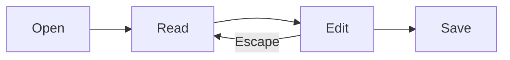
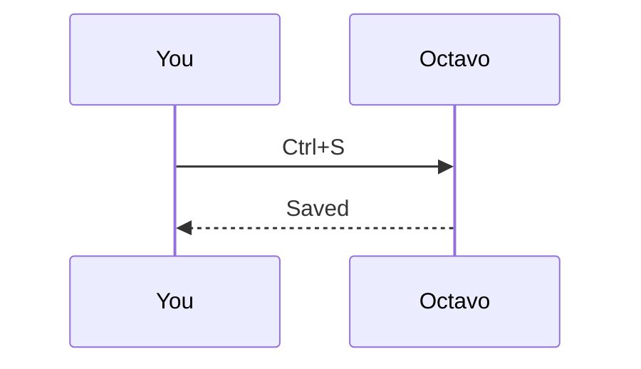

# Octavo showcase

Every element Octavo shows, in one document. Read it, then press **Ctrl+E** to edit it: each section says what to try. Saving writes only the blocks you change, so `git diff` shows exactly your edits.

## Try this while editing

- [ ] Select a few words in this sentence and use the floating bar (Settings → Formatting bar → Floating or Both)
- [ ] Put the cursor in the [table](#tables) and add a row, a column, and change the alignment
- [ ] Click a [formula](#math) and change it; press Escape on another to keep it
- [ ] Change the language of a [code block](#code), then pick Mermaid diagram
- [ ] Insert a footnote at the end of this item
- [ ] Insert an image from `img/` and a horizontal rule
- [x] A task that is already done

## Text

A paragraph with **bold**, _italic_, ***bold italic***, ~~strikethrough~~ and `inline code`. Text on two lines in the file
is one line when shown, until a line break:\
this line follows a backslash line break.

Characters that would format if not escaped: \*not italic\*, \_not italic\_, \`not code\`, \# not a heading, 1\. not a list. HTML entities: &copy; &rarr; &nbsp;(space).

A long word that has to wrap: Pneumonoultramicroscopicsilicovolcanoconiosis, and a long path in code: `C:/Users/someone/Documents/Projects/octavo/src/editor/very/deeply/nested/folder/structure/file-name.md`.

### Headings

#### Heading 4

##### Heading 5

###### Heading 6

## Links

- A web link: [Octavo on GitHub](https://github.com/unsulliedd/Octavo "Opens in your browser")
- A bare link: https://example.com/a/very/long/address/that/has/to/wrap/somewhere/in/the/middle/of/the/line?with=query&and=more
- An email link: <mailto:someone@example.com>
- Another document, opens in a new tab: [GFM fixture](gfm.md)
- A heading in this document: [jump to Footnotes](#footnotes)
- A reference link: [the CommonMark spec][spec]

[spec]: https://spec.commonmark.org "CommonMark"

## Lists

- A bulleted list
  - nested once
    - nested twice
- back at the top

3. A numbered list starting at 3
4. continues at 4
   1. with a nested numbered list

- A loose list item with two paragraphs.

  Its second paragraph.

- And a code block inside a list item:

  ```bash
  npm run tauri dev
  ```

## Quotes

> A quote with **formatting** and a [link](#quotes).
>
> > A quote inside a quote.
>
> - and a list in a quote

---

## Tables

| Left aligned | Centered | Right aligned | Plain |
| :----------- | :------: | ------------: | ----- |
| **bold** | _italic_ | 1,234.50 | `code` |
| a [link](#tables) | ~~struck~~ | 7 | |
| an escaped \| pipe | text | 0.5 | last |

A wide table: with **Wide tables use the window width** on (Reading settings) it grows beside the text column, otherwise it scrolls sideways. Drag a header border to resize a column.

| Feature | Reading | Editing | Saving | Shortcut | Notes |
| ------- | ------- | ------- | ------ | -------- | ----- |
| Tables | resizable columns | rows, columns, alignment | edited rows only | Tab, Shift+Tab | widths are remembered per file and are never written to the Markdown file |
| Code | highlighted, Copy button | language picker | edited block only | Ctrl+Alt+C | languages the reader doesn't know show as plain text |
| Math | KaTeX | popover with preview | source kept as written | | `$` that only look like math, such as prices, stay text |

## Code

Inline `const x = 1;` and fenced blocks with a language:

```typescript
// Highlighted, with the language above the block and a Copy button
export function greet(name: string): string {
  return `Hello, ${name}!`;
}
```

```python
def fib(n: int) -> int:
    return n if n < 2 else fib(n - 1) + fib(n - 2)
```

```json
{ "name": "octavo", "version": "0.5.0", "private": true }
```

```diff
- removed line
+ added line
```

A language the reader doesn't highlight, a block without a language, and a tilde fence:

```zig
const std = @import("std");
```

```
Plain text, no language.
```

~~~
A tilde fence keeps its tildes when saved.
~~~

A very long line scrolls sideways instead of wrapping:

```text
0123456789 0123456789 0123456789 0123456789 0123456789 0123456789 0123456789 0123456789 0123456789 0123456789 0123456789
```

A fence that contains a fence:

````markdown
```js
console.log("inside");
```
````

## Math

Inline math $e^{i\pi} + 1 = 0$, a fraction $\frac{a}{b}$ and Greek $\alpha + \beta = \gamma$.

$$
\int_0^1 x^2 \, dx = \frac{1}{3}
$$

$$
\begin{pmatrix} 1 & 0 \\ 0 & 1 \end{pmatrix}
\begin{pmatrix} x \\ y \end{pmatrix}
=
\begin{pmatrix} x \\ y \end{pmatrix}
$$

Edge cases: prices like $4.99 and $9.99 stay text, \$5 is an escaped dollar, and $5 for $x^2$ keeps only `x^2` as math. A formula with an error shows in red: $\frac{1}{$.

## Diagrams





## Images


[](#images)

A missing image shows a placeholder with its file name and alt text:


## Footnotes

A sentence with a footnote[^1] and another with a named one[^named].

[^1]: The first note, with a [link](#footnotes).

[^named]: Notes can have names instead of numbers; they show numbered in order.

## HTML

Keys like <kbd>Ctrl</kbd>+<kbd>E</kbd>, H<sub>2</sub>O, x<sup>2</sup> and <mark>highlighted text</mark>.

<details>
<summary>A collapsible section</summary>

Its content shows when opened.

</details>

<!-- An HTML comment: kept in the file, not shown -->

Unsafe HTML is cleaned:  shows without running anything.

## Know Limits

Inline code containing `|` inside a table cell makes the editor open a document in Source mode, because it would split the cell. It is shown here only as source, so this document stays editable:

```markdown
| Command | Meaning |
| ------- | ------- |
| `a | b` | pipe |
```

---

The end. Press **Ctrl+E** to go back to reading.
